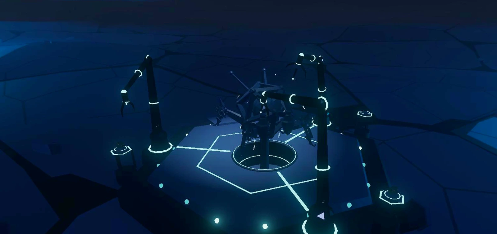

# Autonomy — a programmable bot game: players write the bots, and the bots play

Players write code for their bots, and the bots play on their own in one shared world, once a second.
I have designed and built it solo since November 2025: the server, the sandbox that runs strangers' code, and the Godot client.

*2026-10 — an assembly platform builds a unit part by part, in the Godot client.*

## What I built

- **A server that runs everyone's code, every second.** Each bot runs sealed in its own container with 150 ms of CPU per tick; a broken bot loses its turn, never the game.
- **24 languages listed, Python running end to end.** The game offers only the languages that run today.
- **The same inputs always give the same world.** Every second settles all orders in one fixed order, and tests replay it to prove it.
- **No peeking through the fog of war.** Hidden enemy units are never sent to a player.
- **One client, in Godot.** It only draws what the server sends; there is no browser view yet.
- **Agents write code under checks I set up.** I make every design decision and review every change.

## Milestones

- **2025-11** — A server that runs players' bots inside itself, drawn by a first Godot client on a hexagonal map. It lasted six days: I wanted C# on both sides, so the client moved to Unity.
- **2025-11** — A Unity 2D client on the live server, its hexagons spread across 49 files. All 49 went with the next client, which taught me to keep the map's shape out of the code around it.
- **2025-12** — An Unreal client filling the world with procedural forests and rock. It was too much engine for one person learning to make a first game, and it could not build for the browser.
- **2026-02** — A Unity 3D client, and every bot moved out of the server into its own Docker container. Isolation the operating system gives beats isolation I maintain myself.
- **2026-03** — The first speed tests, and a registry that keeps each player's runtime ready. Measuring before tuning showed where the time really went.
- **2026-05** — Bots kept loaded between ticks, every second waiting for every bot, and the fog of war. Calling bots without waiting for them had made the world differ from run to run, so I reversed it.
- **2026-06** — Each player sent only the changes in their own view, cut on the server. Hiding something in the client is decoration, not protection.
- **2026-07** — A pathfinding rewrite for one seamless world, which made planning moves 13 times slower; speed tests caught it and halved it. A green test suite is not evidence about speed.
- **2026-10** — Godot back as the only client, with Unity archived. Two live clients meant doing every change twice, so the first engine I tried was the right one after all.
- **2026-11** — A playtest build that installs on a clean machine, with Python bots running end to end. A feature is not shipped until a stranger can start it.

## By the numbers

| | |
|---|---|
| Languages the server lists | 24, with Python running end to end (counted 2026-11-15) |
| Automated tests | 2,822 C# test methods (counted 2026-11-15) |
| Server code | ~98,000 lines of C# (counted 2026-11-15) |
| Client code | ~72,000 lines of C# in Godot (counted 2026-11-15) |
| Dated specs | 260 (counted 2026-11-15) |
| Written decision records | 17 (counted 2026-11-15) |
| Built | solo, since November 2025 |

## Explore

- **[The game and its world](docs/the-game-and-its-world.md)** — how it looks, and the five clients it took to get there.
- **[Running strangers' code safely](docs/running-strangers-code-safely.md)** — untrusted bots every second, without breaking the game or seeing too much.
- **[What happens every second](docs/what-happens-every-second.md)** — the loop that turns every bot's orders into one fair result.

## Stack

.NET 10 · ASP.NET Core · EF Core · MediatR · Docker · WebSockets / SignalR · xUnit · BenchmarkDotNet · Godot 4.7 (C#) · GitHub Actions

## Why there is no source here

Keeping the source private is a decision, not an omission. The game is one I intend to keep building and eventually run, and publishing it would mean publishing a working server anyone could stand up as their own. So this repository carries what survives being read rather than run: what the game does, the decisions behind it, and what they cost.

If you are evaluating me and want to see more, ask — [sjogrenandreas@live.se](mailto:sjogrenandreas@live.se).

## Licence

Prose, diagrams and images: CC BY-NC-ND 4.0. See [LICENSE.md](LICENSE.md).

---

**Andreas Sjögren** — contact: [sjogrenandreas@live.se](mailto:sjogrenandreas@live.se) · [github.com/Edes0](https://github.com/Edes0)
