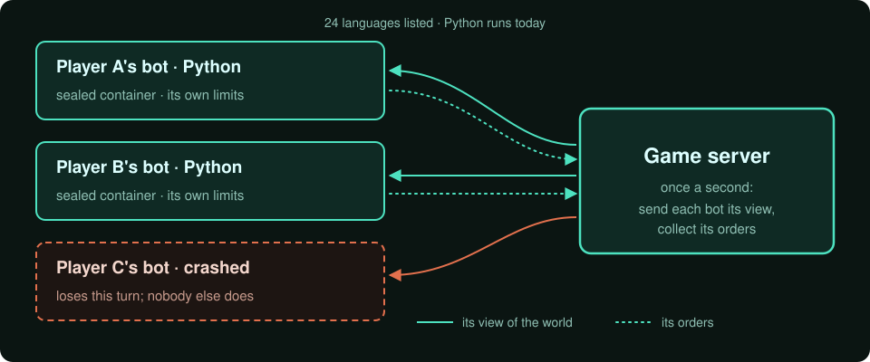

# Running strangers' code safely

Every second, my server runs code written by players it has never met, in whatever language they chose.
The hard part: any bot may crash, hang or reach for what it should not see, and the game has to go on for everyone else.

*2026-11 — one sealed container per bot, one game server that never waits on a broken bot.*

## What it does

- **Each bot runs sealed off on its own**, so a crash or a runaway loop costs only that bot its turn.
- **Every language plays by the same rules**: each bot gets 150 ms of CPU per tick, and time it does not use is saved for later, which rewards efficient code.
- **24 languages are listed, and Python runs end to end today**; the game offers only the languages that run.
- **Bots stay loaded between ticks**, so a bot answers in milliseconds instead of starting up every second.
- **A player is sent only what they may see**: hidden enemy units and other players' private data never leave the server.
- **Compiled languages are built once, at upload**, never on every tick.

## Decisions

### Untrusted code goes in a container

**Context:** The first version ran bots inside the server itself, through WebAssembly, Python.NET and a V8 host, so one bad bot shared the server's memory and could take the game down.
**Decision:** Reversed: every player's bot now runs in its own container, with limits the operating system enforces; hosted judges such as Judge0 and Piston were rejected, as they are built for one-off jobs, not a call every second against a frozen picture of the world.
**Consequence:** Every language runs behind the same rules and a failure stays with its own player, at the price of a round-trip into a container for every bot on every tick.

### A warm worker per player, on by default

**Context:** Starting a fresh process for every bot on every tick used up most of a one-second tick, and a new server could run no bots at all while only logging errors nobody read.
**Decision:** One worker per player stays loaded between ticks, and the server refuses to start when a language it lists has nothing to run in.
**Consequence:** Bots answer in milliseconds and a broken setup fails loudly at start-up; the cost is that a language without a worker cannot run at all, which is why only Python runs today.

### Compile at upload, not per tick

**Context:** Compiled bots were rebuilt inside their container on every tick, which spent the tick's time on the compiler.
**Decision:** A bot is built once, at upload, and can only be switched on after a build that produced a real artifact, not merely a compiler that exited cleanly.
**Consequence:** The build is paid for once per upload, and an upload now has a build state the player must get past before the bot runs.

### The server is the trust boundary

**Context:** Units' private notes were sent to rival players, and a reconnect sent the whole world; the client simply did not draw what it should not show.
**Decision:** Each player's view is cut on the server: private fields never leave it, and a full-world request answers only for the signed-in player; filtering in the client was rejected, since anyone can read their own traffic.
**Consequence:** Tests check what each player actually receives, not what the screen draws, and every path that sends the world has to go through the cut.

### The static world is public

**Context:** With the terrain hidden, scouts could not tell unexplored walls from open ground and walked into mountains, and a colony lived or died by where its scouts happened to look.
**Decision:** Terrain and where resources lie are public to every bot; how much is left, and every unit and building, stay hidden until seen.
**Consequence:** Scouts stopped getting stuck and colonies stopped depending on luck; exploring no longer finds resources.

## Result

- **1–5 ms** per player per tick with a warm worker, against 50–100 ms when every tick started a fresh process: the game's performance notes, recorded by 2026-05.
- **24 languages listed, 1 offered (Python)**: counted in the game's design notes on 2026-11-15.

[← Back to the front page](../README.md)
