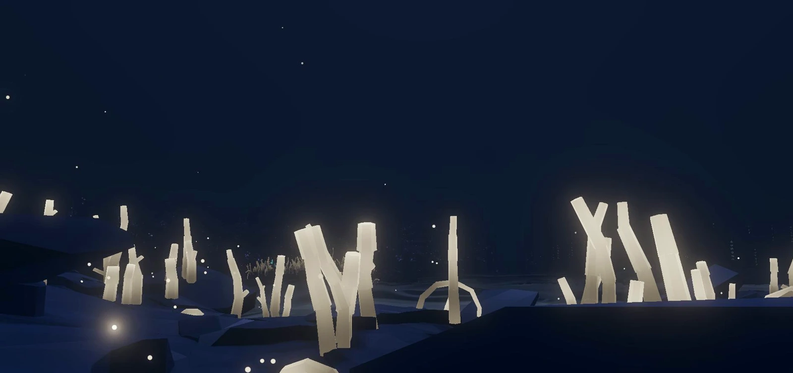
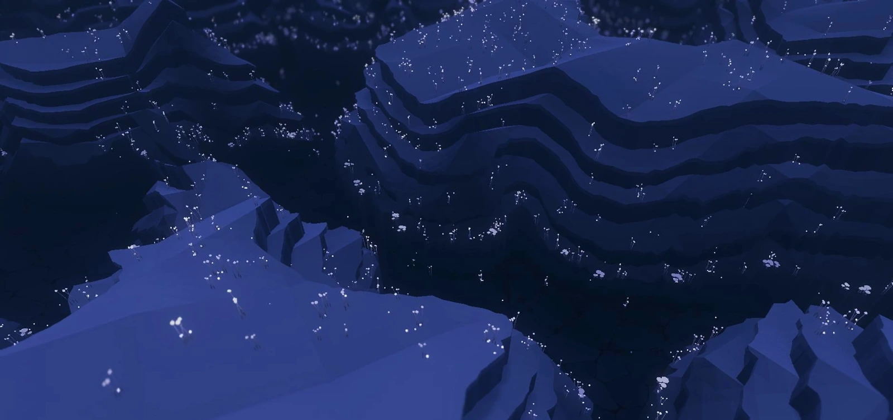
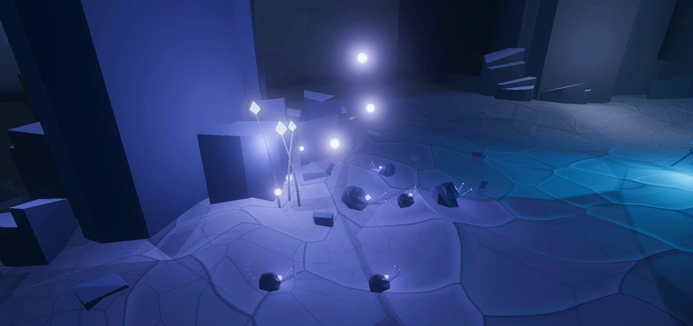
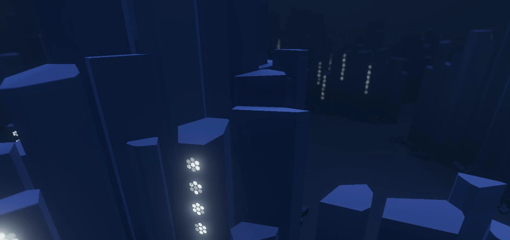

# The game and its world

The world every player's colony lives in, and the Godot client that draws it.
The hard part: one seamless world worth watching, drawn by a client that shows only what the server sends.

<table><tr>
<td width="25%"> 2026-11 — the glass desert at night</td>
<td width="25%"> 2026-11 — the canyon: mesa ledges, glowing fungi</td>
<td width="25%"> 2026-11 — lamp snails light up as a unit walks by</td>
<td width="25%"> 2026-11 — the highland: salt pillars with status lights</td>
</tr></table>

## What it does

- **One seamless world**, generated as one landscape, with no seams where its rooms meet.
- **Biomes with their own rock and light**: the glass desert, the canyon, the highland and more.
- **A night sky with weather**: every night rolls clear, drizzle, snow or a storm.
- **No game logic in the client**: it draws only what the server sends, so a new client can be built in any engine.
- **A fog of war**: a player sees what their units see, and the rest of the world stays dark.
- **No browser view yet**: Godot cannot export C# to the web.

## Decisions

### Godot as the only client

**Context:** Every rule lives on the server: the API, the bots' code, the database. The client only draws what it is sent, and with AI agents and a written art bible, a client can be built from scratch quickly.
**Decision:** Reversed, on purpose: I tried Godot, Unity 2D, Unreal and Unity 3D as ways to show the same game, then came back to Godot as the only client in October 2026; Unity is archived.
**Consequence:** The look was chosen by trying real clients, not by guessing; the price is no browser view yet, since Godot cannot export C# to the web.

### Terrain is a function of global coordinates

**Context:** The world is stored as rooms, and anything generated per room had a visible edge where it met its neighbour.
**Decision:** Terrain is one function of global position, sliced into rooms afterwards, and erosion runs once over the whole field; per-room overlays were rejected.
**Consequence:** One seamless world, and a single room still comes out exactly as before; the price is running erosion over the whole world at once.

### One coordinate grid for bots

**Context:** Bot coordinates reset at every room boundary, so the obvious "move east until x passes 100" broke silently at every seam.
**Decision:** Bots get one continuous grid for the whole world and never learn that rooms exist; room-local coordinates plus a room parameter were rejected.
**Consequence:** Bot code works anywhere in the world; negative coordinates then exposed a rounding bug in two languages' runtimes, fixed by rounding down first.

### Feel beats speed

**Context:** The game is something you drop into and watch, and units that snap from cell to cell every tick are hard to follow.
**Decision:** Visual feel beats engine throughput: a tick that moves smoothly beats a faster one that snaps, so unit movement was slowed to a tenth of its pace for watching, then raised to three tenths.
**Consequence:** Units glide between cells, which is what makes the world worth watching; the price is that they move slower than the engine could move them.

## Result

- **5 clients** built since 2025-11, counted in the game's history and its archived branches: Godot, Unity 2D, Unreal, Unity 3D, then Godot again (counted 2026-11-15).

## Earlier clients

<table><tr>
<td width="25%"> 2025-11 — the first Godot client, 2D hexagons, an earlier client</td>
<td width="25%"> 2025-11 — Unity 2D, still hexagons, an earlier client</td>
<td width="25%"> 2025-12 — Unreal, procedural forests, an earlier client</td>
<td width="25%"> 2026-02 — Unity 3D, eroded terrain (pictured 2026-05), an earlier client</td>
</tr></table>

[← Back to the front page](../README.md)
