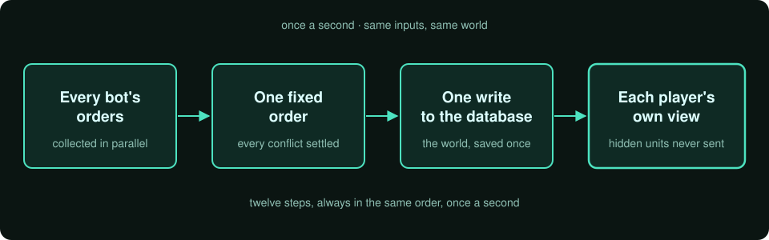

# What happens every second

Once a second, the server turns every bot's orders into one result for the whole world.
The hard part is doing that fairly, and the same way every time, while every player's bot pulls in its own direction.

*2026-11 — one second of the game, from every bot's orders to each player's own view.*

## What it does

- **Every bot's orders are settled in one fixed order**, so the same inputs always produce the same world.
- **Tests run the same second twice** and check that the two worlds match exactly.
- **Clashing moves are settled, not frozen**: units that block each other in a ring rotate instead of standing still.
- **The world is saved in one write per second**, and each player is sent only the changes in their own view.
- **Hidden enemy units are never sent**: a player sees only what their units can see.
- **Speed tests measure every part**, so a slowdown shows up in a test run, not in the game.

## Decisions

### Lockstep inside the tick

**Context:** My first design called the bots without waiting for them, so their orders arrived a second late, landed in an overflow buffer, or never arrived at all.
**Decision:** Reversed: every second now waits for every bot before it settles anything, and a bot that takes too long is cut off and loses only that turn.
**Consequence:** The same inputs always produce the same world, which replay tests enforce; the price is that the slowest bot sets the length of the wait.

### Exempt rotations from cycle exclusion

**Context:** Units that blocked each other in a closed ring froze in place, while the tests for every stage of move resolution passed on their own.
**Decision:** A tight rotation is allowed to move, because its end positions are only a reshuffle of its start positions; every other cycle is still excluded.
**Consequence:** Rings now rotate, and the case it does not yet cover, the slowest units, is written down rather than hidden.

### Instrument before refactoring

**Context:** After a pathfinding rewrite, planning every unit's move got 13 times slower at 5,000 units, every test stayed green, and I had a plausible written explanation of where the memory went.
**Decision:** I measured each call site before changing anything; the explanation covered a sliver of the cost, so the fixes went where the measurements pointed instead.
**Consequence:** The slowdown was halved, not closed, and three more optimisations were measured and left undone because they did not pay.

### World bounds stay hidden from bots

**Context:** Scouts paced along the world's edge because they could not tell "never explored" from "does not exist", and the fix that looked free was to tell every bot the world's size.
**Decision:** The size stays hidden; cells beyond the edge read as impassable, and a cell counts as unexplored only if it is unseen and can be walked on.
**Consequence:** Growing the world is one setting on the server, with no bot to edit and no release to coordinate; every bot pays one extra check to find its edges.

## Result

- **1,409 ms**, down from **2,821 ms**, to plan every unit's move at 5,000 units (216.9 ms before the rewrite): measured 2026-07-24 on one desktop (Ryzen 7 7700X, .NET 10, BenchmarkDotNet). At the low hundreds of units the game actually runs, it takes a few milliseconds.

[← Back to the front page](../README.md)
